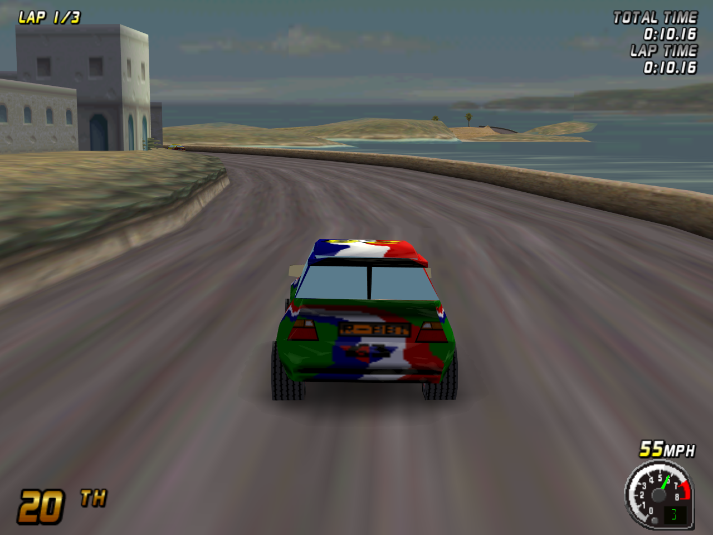
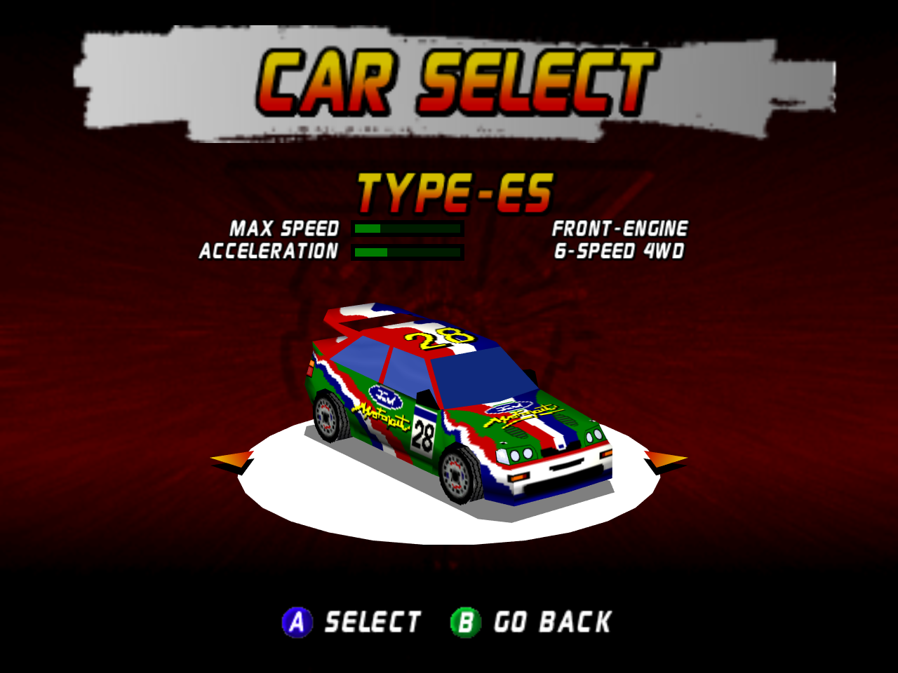
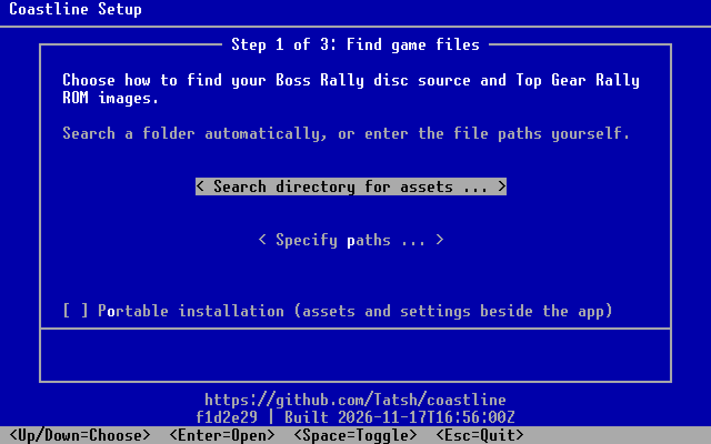
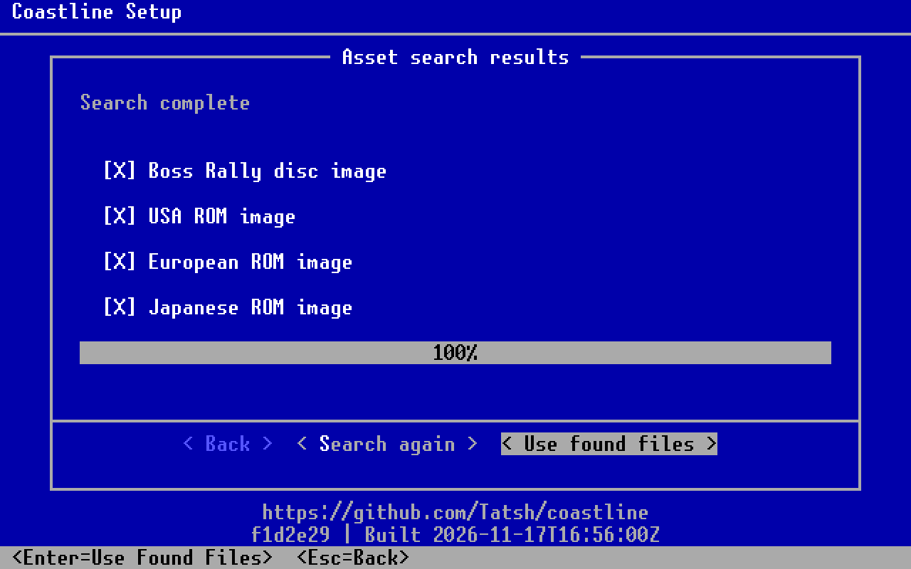

# coastline

<!-- WISWA-GENERATED-README:START -->

[](<https://en.wikipedia.org/wiki/C_(programming_language)>)
[](https://github.com/Tatsh/coastline/tags)
[](https://github.com/Tatsh/coastline/blob/master/LICENSE.txt)
[](https://github.com/Tatsh/coastline/compare/v0.0.4...master)
[](https://github.com/dependabot)
[](https://github.com/Tatsh/coastline/stargazers)
[](https://results.pre-commit.ci/latest/github/Tatsh/coastline/master)
[](https://cmake.org/)
[](https://prettier.io/)

[](https://bsky.app/profile/Tatsh.bsky.social)
[](https://buymeacoffee.com/Tatsh)
[](irc://irc.libera.chat/Tatsh)
[](https://hostux.social/@Tatsh)
[](https://www.patreon.com/Tatsh2)

<!-- WISWA-GENERATED-README:STOP -->

Coastline is Top Gear Rally for modern computers, built from the reconstructed source of the
Nintendo 64 game and its PC release, Boss Rally. It runs on Windows, macOS, and Linux with
Vulkan, Metal, or Direct3D 12.

The repository does not include the data of the games. Coastline imports it from your Boss
Rally disc and Top Gear Rally cartridge images on the first start.

<p>


</p>

## Features

- The championship, arcade, time attack, and two-player races of the Nintendo 64 release, with its
  menus, cars, tracks, and music, driven by the race engine and scenery of Boss Rally.
- Any window size and aspect ratio, internal resolutions up to the display, multisample and
  post-process anti-aliasing, anisotropic filtering, longer draw distances, and CRT screen shaders.
  Presets select the look of the console, of Boss Rally, or of a modern computer.
- Music from the XM modules of the cartridge or the CD audio of the disc, and sound effects of
  either release.
- Keyboard, mouse, and gamepad input, with presets for the controller layouts of the console.
- Saves in files, with export to and import from Controller Pak images for consoles and emulators.
- The paint shop with a mouse, a free camera (F8), screenshots (F9), and frame statistics (F).
- The text, title screens, and textures of the USA, European, and Japanese releases, and asset
  packs for mods.
- Portable installations, and scripted input for unattended runs.

## Quick start

1. Download the package of your system from the
   [latest release](https://github.com/Tatsh/coastline/releases/latest).
   - The `setup.exe` installer or the ZIP file of the portable game for Windows.
   - The `.dmg` disk image with `Coastline.app` for macOS.
   - The AppImage, the Flatpak bundle (`flatpak install --user FILE.flatpak`), the snap
     (`sudo snap install --dangerous FILE.snap`), or the tarball for Linux.
2. Gather a Boss Rally disc image (a CUE sheet with its BIN files gives the CD music) and at least
   one Top Gear Rally ROM image of the USA, European, or Japanese release.
3. Start Coastline. The setup wizard finds the images and imports them;
   [First run](docs/first-run.md) shows each step.

<p>


</p>

A gamepad drives the menus and the races. On the keyboard, the arrow keys move through the menus,
X selects, C goes back, and Enter is Start. A race uses the keyboard bindings of Boss Rally. The
arrow keys steer, accelerate, and brake, A and Z change gear, and Escape pauses.
[Controls](docs/controls.md) lists every binding.

## Documentation

- [First run](docs/first-run.md) shows the setup wizard and the files it needs.
- [Controls](docs/controls.md) lists the keyboard, the free camera, and the gamepad bindings.
- [Display](docs/display.md) covers presets, video settings, scaling, and screen shaders.
- [Game options](docs/options.md) covers saving, units, music, sound effects, and visual effects.
- [Data and saves](docs/data.md) covers directories, portable installations, saves, and resets.
- [Importing game data](docs/import.md) lists the disc formats and the `import` command.
- [Language](docs/language.md) describes the text and fonts of each release.
- [Asset packs](docs/asset-packs.md) describes the Boss Rally pack, mods, and intro sequences.
- [Command line](docs/command-line.md) lists the options, subcommands, and scripts.
- [Building](docs/building.md) covers the SDL game, packages, the Nintendo 64 releases, the Windows
  libraries, and tests.

## Building from source

The `coastline` preset builds the game with the libraries of vcpkg. Without vcpkg, the build
downloads pinned releases of the libraries. [Building](docs/building.md) lists the options and the
packages.

```shell
VCPKG_ROOT=/path/to/vcpkg cmake --workflow --preset coastline
```

## Reconstruction

The source reconstructs the three Nintendo 64 releases in C, built with IDO 5.3, and the renderer
libraries of Boss Rally in C++, built with MSVC. The presets `tgr-us`, `tgr-asia`, `tgr-jp`, and
`tgr-eu` build the cartridge images, and `boss-rally` builds the Windows libraries.
[PROGRESS.md](PROGRESS.md) records which routines of each release compile to the original code,
with a page for each part of the program.
