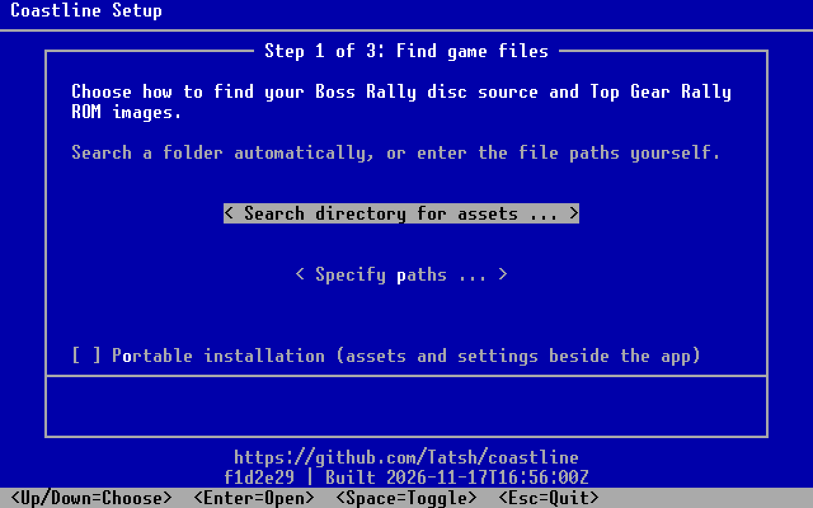
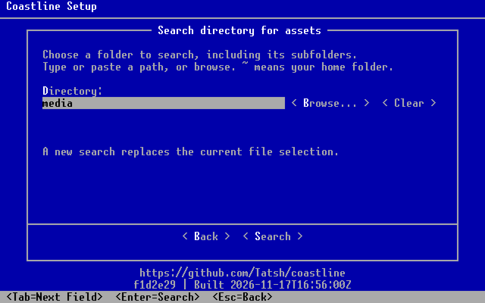
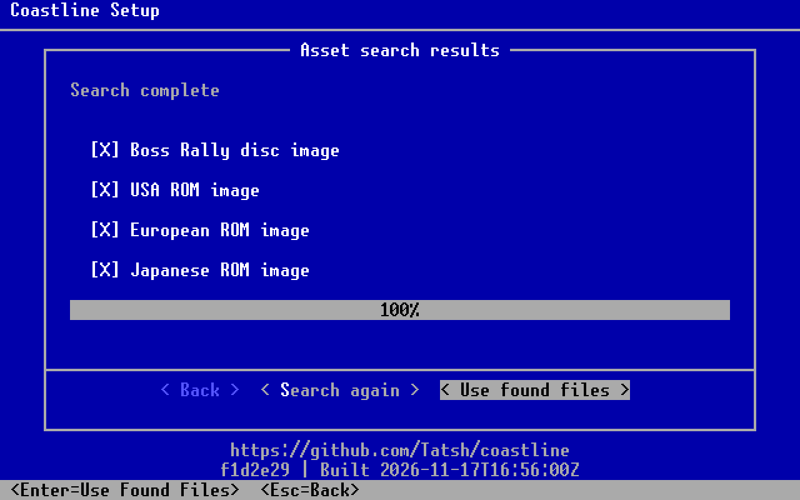
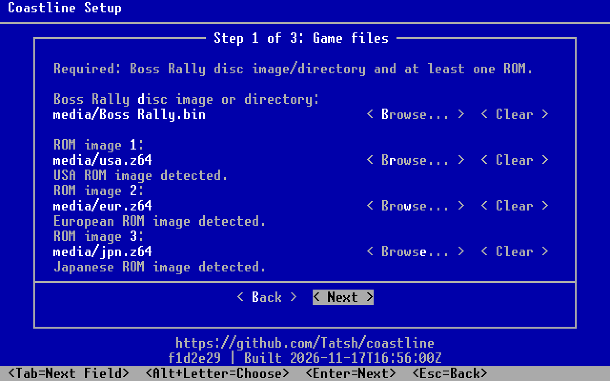
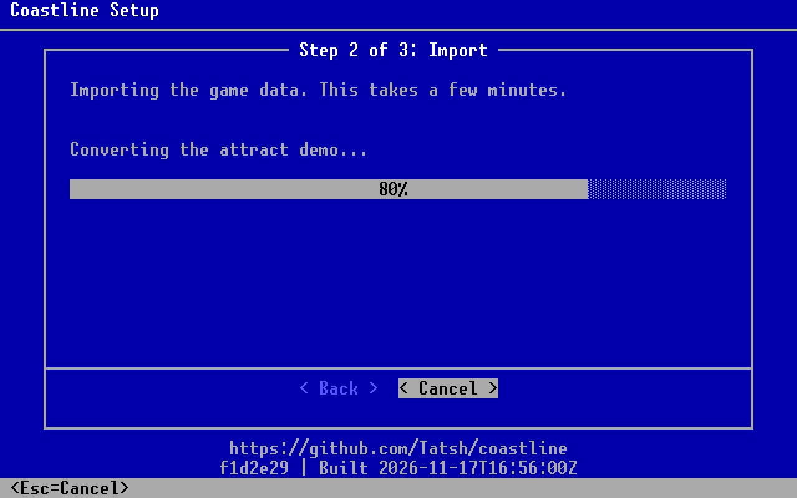
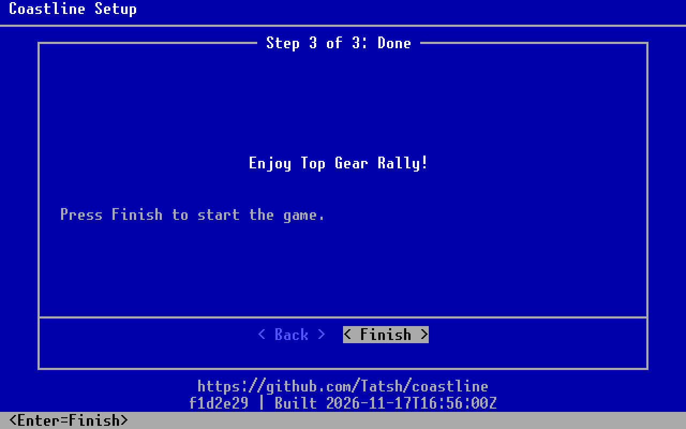

# First run

Coastline needs the data of the original games, and no copyrighted data is distributed with it.
Before the first start, gather these files:

- A Boss Rally disc image (CUE sheet with its BIN files, a BIN, an ISO, or one of the other formats
  of [Importing game data](import.md)), or the files of the disc copied to a directory. A CUE
  sheet or a verified BIN provides the CD music; an ISO or a directory provides data only.
- At least one Top Gear Rally cartridge image (`.z64`) of the USA, European, or Japanese release.
  Each additional release adds its regional textures, title screen, and language.

Start `coastline`. Without usable game data, the game opens the setup wizard in its window. The
wizard imports the data once, and the game starts when it finishes.

## Game file search



The first screen offers two ways to locate the files. **Search directory for assets** scans a
folder and its subfolders. **Specify paths** opens the file fields directly. Up and Down choose,
Enter opens, and Escape quits setup.

**Portable installation** stores the imported assets and the settings beside the application in
place of the platform directories. The checkbox is unchecked for new installations, and
[Data and saves](data.md) describes portable storage.

### Directory search



Type or paste the folder that has the images, or press **Browse**. An initial `~` expands to the
home directory. Ctrl+A selects all text, Ctrl+V pastes, and Alt+Backspace deletes a word. Enter
starts the search.



The search includes hidden files and folders, skips `.` and `..`, and does not follow directory
symlinks. It checks each ROM image by SHA-1 and lists each image it finds during the search. ZIP
archives are searched for ROM images, including entries in subfolders. Stored and deflated entries
are checked by CRC and ROM SHA-1, and valid ROMs are extracted to `asset-search` in the user cache.
Encrypted, corrupt, oversized, and unsupported archive entries are skipped. The search also
detects disc directories. **Use found files** fills the fields of the next screen with the results.

### Game files



The disc field and three interchangeable ROM fields display the selected paths. Each field reports
the release it detected or the reason the file cannot be used. Every field has **Browse** and
**Clear** buttons. Alt and the underlined letter of a label moves to its control. **Next** becomes
available once the disc and at least one ROM image are valid.

To select a disc directory in the browser, open the directory with `BossRally.pod` inside it and
choose **Use this directory**.

## Import



The import converts the disc data, the CD audio, and every cartridge, and takes a few minutes.
**Cancel** stops the import and returns to the first step. A failed or cancelled import does not
replace previous assets, and the screen reports the reason for a failure.

## Completion



**Finish** starts the intro in the same window. The next start goes directly to the game.

## After setup

The game saves its settings to `BossRally.ini` (`~/.config/coastline` on Linux), and
[Data and saves](data.md) lists the directories of each platform. Press F9 for a screenshot and F
for the frame rate. [Controls](controls.md) lists the keyboard and gamepad bindings, and
[Game options](options.md) and [Display](display.md) describe the settings.

`coastline --reset` removes the imported packs and asset caches and starts setup again. Saves,
settings, and custom asset packs are preserved. A new release of Coastline that changes the
imported formats reports that the assets are outdated and offers the import again.

The `import` subcommand runs the same import without a window.

```shell
coastline import --cd 'Boss Rally.cue' --rom usa.z64 --rom jpn.z64
```

Builds with `COASTLINE_INSTALL_ASSETS=ON` install the converted data with the game and omit the
wizard; [Building](building.md) describes them.
